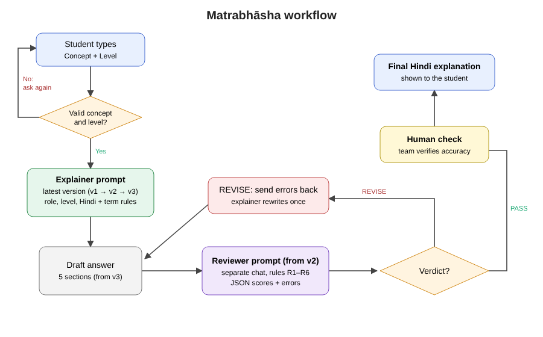

# Matrabhāsha

A prompt workflow that explains introductory computer science concepts in natural, conversational Hindi to Hindi-comfortable
learners at two knowledge levels: **Beginner** (no programming background) and **Intermediate** (knows programming basics, wants
technical depth), whatever their year or degree. Technical terms stay in English with a short Hindi gloss, and every answer includes an everyday
analogy, a common misconception and practice questions. A second reviewer prompt checks each answer before a team member verifies it.

Prompt Engineering mini-project, B.Tech CSE 5th semester, Bennett University. Problem Pool ID **C19** (Bilingual explainer).

**Team SyntaxAI:** Suhani Jain (leader), Khushi Upadhyay, Amna Khan, Ashima Singh

## How it works
1. The student sends `Concept: <name> | Level: Beginner` (or `Intermediate`).
2. The **explainer prompt** answers. It is developed in versions (v0 baseline → v1 short → v2 guided → v3 final), and each
   version is adopted only after real runs of the previous one show what it gets wrong. See [prompts/README.md](prompts/README.md).
3. From v2 on, the **reviewer prompt** ([prompts/reviewer_prompt.md](prompts/reviewer_prompt.md)) scores it and returns PASS or REVISE with quoted errors.
4. On REVISE the explainer rewrites once; a team member checks accuracy before the answer is used.

The prototype is a Gemini Gem (plus a Custom GPT / Claude Project for comparison). Setup: [build/build_guide.md](build/build_guide.md).

## Reproduce the evaluation
- Test set: [test-set/test_set.csv](test-set/test_set.csv) (25 concepts × 2 levels) and [test-set/edge_cases.csv](test-set/edge_cases.csv).
- Conditions: V0 baseline, TR English + Google Translate, V1, V2, V2R (v2 + reviewer); V3 and V3R in Milestone 3.
- Rubric and forms: [evaluation/](evaluation/). Raw model outputs go in [outputs/](outputs/), copied exactly.
- Pilot and demo steps: [build/demo_plan.md](build/demo_plan.md).

## Repository layout
| Folder | Contents |
|---|---|
| `prompts/` | Prompt versions v0–v3 with version history, reviewer prompt, few-shot examples |
| `test-set/` | Test cases and edge cases |
| `outputs/` | Raw model outputs and reviewer JSON |
| `evaluation/` | Rubric, scoring sheets, experiment log, student rating form |
| `design/` | Design description and diagrams |
| `build/` | Prototype build guide and demo plan |
| `docs/` | Synopsis, video script, Milestone 2 plan |
| `screenshots/` | Gem/GPT setup and demo evidence |

Contribution record: [CONTRIBUTIONS.md](CONTRIBUTIONS.md).

## Status
Milestone 1 submitted. Milestone 2 (due 2 Nov 2026): prompts, test set and rubric drafted; pilot runs and scoring in progress.
All results in this repository come from the team's own runs.

## References
- Bennett University, Prompt Engineering Mini-Project Guidelines, 2026.
- Careers360, "UGC issues guidelines for translation of books in Indian languages".
- Ministry of Education, National Education Policy 2020.
