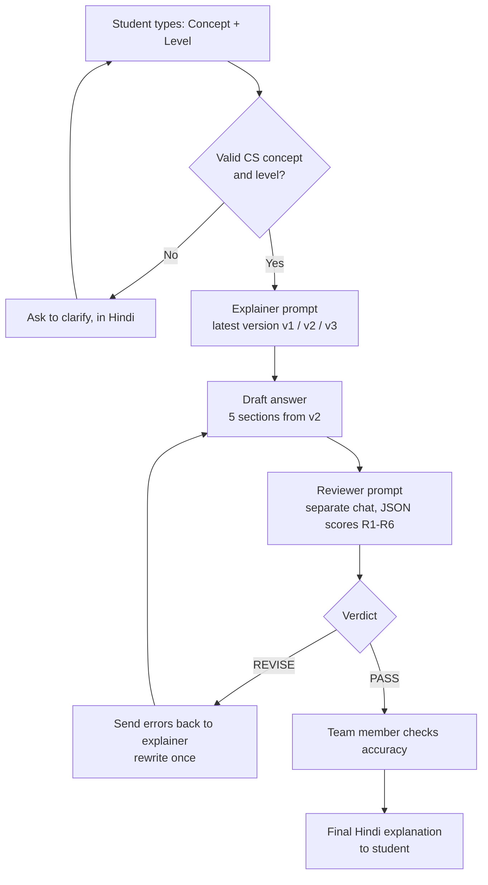
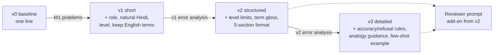
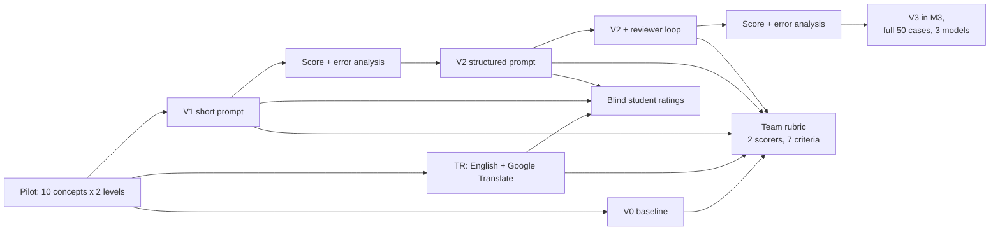

# Matrabhāsha: prompt and solution design (M2 component 1, 2 marks)

## 1. What the system does
**Input:** a first-year CS concept + a level (Beginner or First-year).
**Output:** a natural-Hindi explanation in 5 fixed sections (explanation, analogy, key terms, misconception, practice),
checked by a second reviewer prompt and a human before it is used.

## 2. Task decomposition
The one big task ("explain this in Hindi") is split into smaller prompt tasks. The explainer prompt grows in versions
(v0 → v3, see section 4), so the version in brackets says when each part is added.

| Step | Who/what | Prompt technique |
|---|---|---|
| 1. Read input, check it's a valid CS concept and level | Explainer prompt (v3) | Input validation, refusal rule |
| 2. Write explanation at the right depth | Explainer prompt (v1 level, v2 limits) | Role + audience-aware prompting, level constraints |
| 3. Handle technical terms | Explainer prompt (v1 keep English, v2 gloss) | Constraint: English term + Hindi gloss |
| 4. Keep format fixed | Explainer prompt (v2 format, v3 example) | Structured output, few-shot example |
| 5. Check accuracy, terms, tone, level, format | Reviewer prompt (separate chat) | Prompt chaining, LLM-as-judge, JSON output |
| 6. Fix flagged problems | Explainer prompt (revision message) | Self-refinement from feedback |
| 7. Final accuracy check | Team member | Human oversight |

## 3. Workflow diagram
Image version: `workflow.png` (ready for slides/report) and `workflow.svg` (editable). It shows the full planned workflow; the input check arrives with v3 and the reviewer from v2, so v1 is just "input → explainer → answer".

## 4. Prompt architecture: the version ladder
Each version keeps everything from the one before and adds only what the previous version's real failures showed was needed.

The arrows are the evidence steps: a version is only adopted after the previous one has been run, scored and its failures
logged in `evaluation/error_analysis.md`. The v2 and v3 contents above are the planned additions and get edited to match what
the team actually finds.

## 5. Evaluation flow

## 6. Interface
No-code prototype: a **Gemini Gem** (main) and a **Custom GPT** (backup), both using the same instructions: the latest adopted version (update the Gem each time a new version is adopted).
The student just types `Concept: Stack | Level: Beginner`. The reviewer is a second Gem/GPT.
See `build/build_guide.md`.

## 7. Responsible-AI design choices
- No personal data: inputs are only concept names. Student ratings are anonymous.
- Hallucination: accuracy rules in the prompt + reviewer + human check before use.
- Bias/inclusion: analogies from everyday Indian life, not region- or religion-specific; reviewers watch for this.
- Copyright: outputs are generated; the team's few-shot examples are original. No textbook text is pasted in.
- Limit stated to users: "AI-generated, verify with your teacher."

## How to view the mermaid diagrams
GitHub shows them automatically. Elsewhere, paste a block into https://mermaid.live and export PNG.
