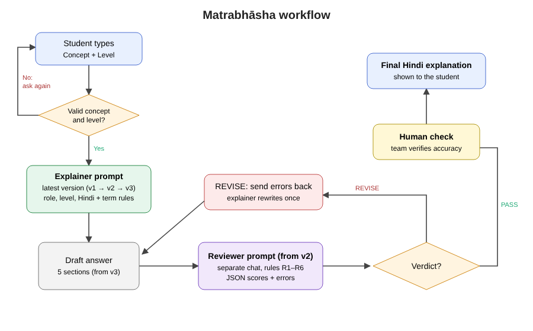

# Synopsis: Milestone 2

**Title:** Matrabhāsha: A Prompt-Engineered Bilingual Explainer for Introductory Computer Science Concepts in Hindi  
**Team:** SyntaxAI (Suhani Jain, leader; Khushi Upadhyay; Amna Khan; Ashima Singh), B.Tech CSE 5th semester, Bennett University  
**Problem ID:** C19 (Bilingual explainer)

## Abstract
Many Hindi-comfortable learners, such as Hindi-medium first-year B.Tech students, struggle with CS concepts taught only in
English, and machine translation gives stiff, word-for-word Hindi that ignores what the learner already knows. Matrabhāsha is a
prompt workflow that explains an introductory CS concept in natural, conversational Hindi at two knowledge levels (Beginner: no
programming background; Intermediate: knows programming basics), keeping technical terms in English with a short Hindi
gloss, and adding an everyday analogy, a common misconception and practice questions. A second reviewer prompt checks each answer
for accuracy, term use, naturalness, level fit and format, and a team member verifies accuracy before use. We built the workflow as
no-code Gemini Gems and developed the prompt in versions, from a one-line baseline (v0) to a short role prompt (v1) and a
guided prompt (v2), with each change driven by failures found in the previous version. We piloted all three versions on 20 test
cases from a 50-case test set (60 runs on Gemini Flash), plus 6 edge cases on v1 and v2. v2's natural-Hindi rule removed Roman
Hinglish completely (6 of 20 answers in v1, 0 of 20 in v2), but no version gave practice questions (0 of 60 runs) and Beginners
still received code in 3 of 10 cases in every version, which is the evidence for the final prompt (v3) in Milestone 3.

## 1. Problem and users
Primary users are Hindi-comfortable learners of introductory CS at any year or in any programme, with Hindi-medium first-year
B.Tech students as the main group; secondary users are teachers/TAs who re-explain concepts in Hindi. NEP 2020 encourages
mother-tongue learning, and UGC guidance on translated books asks that word-to-word output be rephrased and that technical terms
be kept in English. Existing tools (machine translation, general chatbots, AICTE's Anuvadini) translate text but do not adapt to
learner level or add analogies and practice.
Levels are defined by prior knowledge rather than year of study. (Milestone 1 used "First-year B.Tech" as the second level; it was
renamed Intermediate so that, for example, a second-year student or a non-B.Tech learner with the same knowledge fits.)

## 2. Objectives
1. Develop, in evidence-driven versions (v0 to v3), a prompt that produces natural Hindi explanations at two learner levels with a 5-part structure.
2. Add a reviewer prompt that catches accuracy, terminology and format problems (prompt chaining).
3. Evaluate against a baseline prompt (v0) using a rubric and blind student ratings.

## 3. Method / prompt design
- **Explainer prompt, built as a version ladder:**
  - v0: one-line baseline, "Explain &lt;concept&gt; in Hindi for a &lt;level&gt; learner" (plain Gemini Flash, no Gem).
  - v1: a friendly CS teacher role and the learner level only (Gem "Matrabhāsha v1").
  - v2: natural Hindi in Devanagari instead of literal translation, technical terms kept in English, and a definition of each
    level. Adopted because v1 answered 6 of 20 cases in Roman Hinglish and its level depth was uneven (code for Beginners in
    T01, T07, T13; Intermediate ranging from Python-only basics in T02 to recurrence relations and DP in T08).
  - v3 (Milestone 3, final version): level limits including no code for Beginners, term gloss rule (English term + short Hindi
    meaning), fixed 5-section output, accuracy rules, analogy guidance and one team-written few-shot example, plus scope,
    level and role rules for the edge-case failures, only as far as v2 failures call for them.
- **Reviewer prompt (used with the final prompt, v3):** separate chat; scores rules R1 to R6 and returns JSON with quoted errors
  and a PASS/REVISE verdict; on REVISE the explainer rewrites once.
- **Human oversight:** a team member verifies technical accuracy before an output is used.
- **Prototype:** Gemini Gems for v1 and v2 (setup and chat screenshots in the repository).

## 4. Evaluation design
- Test set: 25 introductory CS concepts (programming, data structures, algorithms, OS, DBMS) × 2 levels = 50 cases, plus 6 edge cases.
- Milestone 2 pilot: 20 of the 50 cases (10 Beginner, 10 Intermediate), 5 per team member, each run under V0, V1 and V2 on
  Gemini Flash (60 runs, 31 Oct to 1 Nov 2026). Edge cases E01 to E06 run on V1 and V2 only. Every run is logged in
  `evaluation/experiment_log.csv` and every failure is quoted in `evaluation/error_analysis.md`.
- Conditions: V0 baseline, V1 short prompt, V2 guided prompt. The reviewer was pilot-tested on one V2 answer (T01); full V3R runs
  (v3 + reviewer) are planned for Milestone 3.
- Team rubric (1 to 5, two independent scorers): accuracy, natural Hindi, term handling, level fit, analogy, completeness,
  practice questions; hallucination flag. Scoring is planned for Milestone 3.
- Blind student ratings (anonymous Hindi-speaking classmates): naturalness, clarity, usefulness. Planned for Milestone 3.

## 5. Pilot results (Milestone 2)
Counts are from reading every output file (20 runs per condition: 10 Beginner, 10 Intermediate). Rubric scores and student
ratings are not done yet, so the table shows failure counts, not scores.

| Pattern (out of 20 runs unless stated) | V0 baseline | V1 short | V2 guided |
|---|---|---|---|
| Answer in Roman Hinglish | 0 | 6 | **0** |
| Code given to a Beginner (of 10) | 3 | 3 | 3 |
| No practice questions | 20 | 20 | 20 |
| Target misconception named and corrected | 0 | 1 | 3 |
| Target misconception not addressed at all | 6 | 9 | 8 |
| A required key point missing | 6 | 10 | 9 |
| Factual error (hallucination candidate) | 3 | 4 | 4 |
| Closing line in English | 0 | 2 | 5 |
| Theatrical opener ("अरे…") | 0 | 1 | 6 |
| Edge cases handled correctly (of 6) | not run | 3 | 2 |

**Reviewer pilot (T01, V2 answer):** the team ran the reviewer once, on one V2 answer, as a test. It gave a verdict of REVISE with 4 errors (code at Beginner level, 348 words against the
250 limit, missing the 5 sections, analogy limit not stated). These match failures we found by hand. It missed the clumsy
ordinals "2रा, 3रा" and the missing target misconception, so the human check stays. Full V3R runs on the final prompt are
planned for Milestone 3.

**Failures of v1 that led to v2:** Roman Hinglish in 6 of 20 answers (for example T45 "Namaste! Main aapka computer science
teacher hoon") and mixed scripts ("डेडlock", Gujarati letters in T42); no level definition, so depth varied widely and the
infinite-mirror analogy in T07 reinforced the no-base-case misconception.

**Failures of v2 that will shape v3:** no fixed structure (no practice questions in any answer, misconception named in only 3
of 20); Beginners still get code in T01, T07 and T13 because v2 never says "no code"; key points missing in 9 of 20 and
factual errors in 4 of 20 (for example T46 claims every Primary Key creates a clustered index); v2's "good teacher in class"
wording added theatrical openers (6 of 20) and English closing lines (5 of 20); and in the edge cases both versions answered
an out-of-scope topic (E01), accepted an "Expert" level (E03) and wrote a cricket poem when told to ignore their rules (E05),
while v2 answered fully in English when asked to (E04).

## 6. Responsible AI
No personal data is entered (inputs are concept names only); student ratings will be anonymous. Hallucination is reduced by
accuracy rules, the reviewer step and a human check, and the tool tells users to verify with their teacher. Few-shot examples
are the team's own writing; no copyrighted textbook text is used as input. The edge-case runs showed the current prompts
follow role-changing instructions (E05), so v3 adds a rule to refuse them.

## 7. Limitations and next steps (Milestone 3)
The pilot used one model (Gemini Flash) and 20 of the 50 cases, and failure counts come from the team reading outputs, not from
scored rubrics yet. Accuracy did not improve from v0 to v2 (3 to 4 factual errors per 20), v2 traded some errors for new ones
(T08, T46), and the reviewer is weak on naturalness and on which misconception is addressed. Next: finalise v3 with the format,
no-code, key-point, accuracy, scope, level and role rules; run v3 with the reviewer loop (V3R) on the full 50-case test set on
ChatGPT, Gemini and Claude; score with the rubric (two scorers); collect blind student ratings; final report and video.

## Team contributions
All four members ran their own 5 pilot cases under V0, V1 and V2 and logged them.

- **Suhani Jain (leader):** Gemini Gems, Git repository, pilot runs.
- **Khushi Upadhyay:** syllabus check of the test set, pilot runs.
- **Amna Khan:** pilot runs, video narration.
- **Ashima Singh:** pilot runs, edge cases E01 to E06, slides.

The error analysis and this synopsis were compiled from everyone's logged runs.

## References
1. Bennett University, Prompt Engineering Mini-Project Guidelines, 2026.
2. Careers360, "UGC issues guidelines for translation of books in Indian languages", https://news.careers360.com/ugc-issues-guidelines-for-translation-of-books-in-indian-languages/amp
3. Ministry of Education, National Education Policy 2020.
4. Tools used: Google Gemini (Gemini Flash and Gemini Gems), all Milestone 2 runs between 31 October and 1 November 2026.
   OpenAI ChatGPT and Anthropic Claude are planned for the Milestone 3 cross-model runs.
