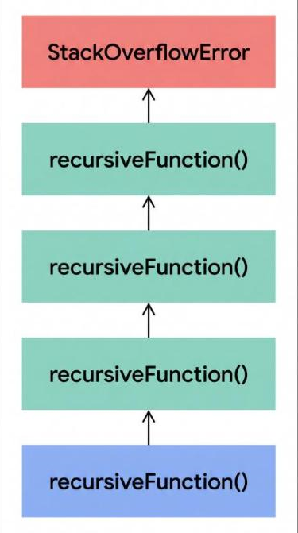

# T07 · Recursion · Beginner · V0 (Gemini Flash, no Gem) · 2026-10-31 · Suhani

Input: `Explain Recursion in Hindi for a Beginner learner`

Output (copied unchanged):

---

**Recursion (रिकर्जन)** का सीधा सा मतलब है: **जब कोई फ़ंक्शन (Function) खुद को ही बार-बार कॉल (Call) करता है**, जब तक कि कोई तय सीमा (Condition) न आ जाए।

सरल शब्दों में, किसी बड़ी समस्या को छोटी-छोटी एक जैसी समस्याओं में तोड़कर हल करने के तरीके को रिकर्जन कहते हैं।

### रियल लाइफ उदाहरण: रूसी गुड़िया (Matryoshka Doll)

मान लीजिए आपके पास एक बड़ी लकड़ी की गुड़िया है।

1. आप उसे खोलते हैं, तो अंदर एक और छोटी गुड़िया मिलती है।
2. आप उसे भी खोलते हैं, तो अंदर फिर एक छोटी गुड़िया मिलती है।
3. आप तब तक खोलते रहते हैं जब तक सबसे छोटी गुड़िया न मिल जाए जो खुल नहीं सकती।

यहाँ हर बार गुड़िया खोलने की प्रक्रिया एक ही है—यही **Recursion** है। सबसे छोटी गुड़िया जहाँ प्रक्रिया रुक जाती है, उसे **Base Case** कहते हैं।



### Recursion के 2 मुख्य हिस्से

किसी भी रिकर्सिव प्रोग्राम में दो चीज़ें होना अनिवार्य हैं:

1. **Base Case (रुकाने वाली शर्त):** वह स्थिति जहाँ रिकर्जन रुक जाता है। अगर यह न हो, तो प्रोग्राम कभी नहीं रुकेगा और कंप्यूटर की मेमोरी फुल हो जाएगी (जिसे **Stack Overflow Error** कहते हैं)।
2. **Recursive Case:** वह कोड जहाँ फ़ंक्शन खुद को एक छोटे इनपुट के साथ दोबारा कॉल करता है।

### आसान कोड उदाहरण (Factorial निकालना)

गणित में $5!$ (5 का फ़ैक्टोरियल) = $5 \times 4 \times 3 \times 2 \times 1 = 120$ होता है।

इसे रिकर्जन से ऐसे लिखा जा सकता है:

$$\text{Factorial}(n) = n \times \text{Factorial}(n - 1)$$

**Python में कोड:**

```python
def factorial(n):
    # 1. Base Case: जब n 1 हो जाए, तो रुक जाओ
    if n == 1:
        return 1
    
    # 2. Recursive Case: फ़ंक्शन खुद को कॉल कर रहा है
    else:
        return n * factorial(n - 1)

print(factorial(5)) # Output: 120
```

### यह बैकग्राउंड में कैसे काम करता है?

जब आप `factorial(5)` कॉल करते हैं:

* `factorial(5)` रिटर्न करता है: `5 * factorial(4)`
* `factorial(4)` रिटर्न करता है: `4 * factorial(3)`
* `factorial(3)` रिटर्न करता है: `3 * factorial(2)`
* `factorial(2)` रिटर्न करता है: `2 * factorial(1)`
* `factorial(1)` **Base Case** पर पहुँचता है और `1` रिटर्न करता है।

इसके बाद सभी मान वापस मल्टीप्लाई होते हुए उत्तर **120** देते हैं।

### Loops (फॉर/वाइल लूप) और Recursion में अंतर

| विशेषता | Loop (लूप) | Recursion (रिकर्जन) |
| --- | --- | --- |
| **तरीका** | कोड को बार-बार दोहराता है। | फ़ंक्शन खुद को बार-बार कॉल करता है। |
| **रुकने का तरीका** | Condition गलत होने पर रुकता है। | Base Case आने पर रुकता है। |
| **मेमोरी** | कम मेमोरी लेता है। | Call Stack में जगह लेने के कारण ज्यादा मेमोरी लेता है। |
| **इस्तेमाल** | सीधे-साधे दोहराव के लिए। | Tree या Graph जैसे जटिल डेटा स्ट्रक्चर के लिए। |
