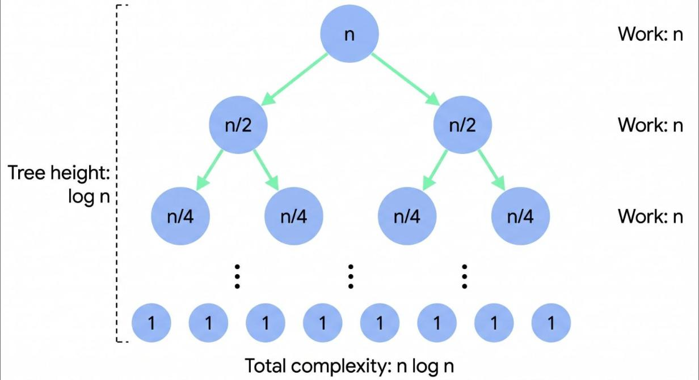

# T08 · Recursion · Intermediate · V0 (Gemini Flash, no Gem) · 2026-10-31 · Suhani

Input: `Explain Recursion in Hindi for a Intermediate learner`

Output (copied unchanged):

---

**Recursion (पुनरावृत्ति)** एक ऐसी Programming Technique है जहाँ कोई Function अपने कार्य को पूरा करने के लिए खुद को ही Call करता है (Directly या Indirectly)।

Intermediate level पर, Recursion को सिर्फ "एक Function जो खुद को Call करे" समझने के बजाय, इसे **Problem Decomposition (समस्या को छोटे भागों में तोड़ना)** और **Call Stack Management** के रूप में समझना जरूरी है।

## 1. Recursion के 2 मुख्य Pillar

हर Recursive Problem दो भागों में विभाजित होती है:

1. **Base Case (रुकने की शर्त):** वह स्थिति जहाँ Function खुद को Call करना बंद कर देता है और Direct Value Return करता है। अगर Base Case गायब हो या गलत लिखा हो, तो Program Infinite Loop में फँस जाएगा और **Stack Overflow Error** देगा।
2. **Recursive Step (आगे बढ़ने का नियम):** वह स्थिति जहाँ Function समस्या के एक छोटे Version (`n - 1` या `n/2`) के साथ खुद को दोबारा Call करता है।

## 2. Dry Run: Factorial Function ($n!$)

इसे समझने के लिए `Factorial` का उदाहरण लेते हैं ($5! = 5 \times 4 \times 3 \times 2 \times 1$):

```python
def factorial(n):
    # Base Case
    if n == 1 or n == 0:
        return 1
    
    # Recursive Step
    return n * factorial(n - 1)
```

### Execution Phasing (Call Stack कैसे काम करता है)

Recursion दो phases में execute होता है:

* **Winding Phase (Call Stack में Push होना):**

  * `factorial(3)` $\rightarrow$ returns $3 \times$ `factorial(2)`
  * `factorial(2)` $\rightarrow$ returns $2 \times$ `factorial(1)`
  * `factorial(1)` $\rightarrow$ **Base Case Reached!** Returns $1$.
* **Unwinding Phase (Values Return होना और Pop होना):**

  * `factorial(1)` returns $1$ to `factorial(2)`
  * `factorial(2)` calculates $2 \times 1 = 2$ and returns to `factorial(3)`
  * `factorial(3)` calculates $3 \times 2 = 6$ (Final Result)

## 3. Recursion vs Iteration (Loop)

| Feature | Recursion | Iteration (Loop) |
| --- | --- | --- |
| **Memory Usage** | **High** (हर call के लिए Stack Frame बनता है) | **Low** (O(1) Auxiliary Space) |
| **Code Structure** | Clean, Concise, और Mathematical | Verbose (कभी-कभी बड़ा Code लिखना पड़ता है) |
| **Performance** | Function Call Overhead के कारण धीमा हो सकता है | तेज़ Execution |
| **Best Used For** | Tree Traversal, Graph DFS, Divide and Conquer | Simple Linear Search, Arrays Processing |

## 4. Advanced Concepts for Intermediate Learners

### A. Call Stack Visual & Time Complexity

नीचे दिए गए Tree Diagram से समझें कि Merge Sort या Divide and Conquer algorithm में Recursion समस्याओं को आधा-आधा करके कैसे सुलझाता है:



### B. Tail Recursion Optimization

अगर Recursive Call Function की **आखिरी Statement** हो और उसके बाद कोई Operation (जैसे Multiplication/Addition) न बचा हो, तो उसे **Tail Recursion** कहते हैं।

```python
# Non-Tail Recursive (पेंडिंग Multiplication बचा रहता है)
def fact(n):
    if n == 1: return 1
    return n * fact(n - 1)

# Tail Recursive (accumulator का उपयोग करके)
def fact_tail(n, accumulator=1):
    if n == 1: return accumulator
    return fact_tail(n - 1, n * accumulator)  # Last statement is pure function call
```

> **Note:** आधुनिक Compiler/Interpreters (C++, Java, Scala) Tail Recursion को पहचानकर O(1) Stack Space में बदल देते हैं, जिससे Stack Overflow का खतरा खत्म हो जाता है।

### C. Tree Traversal & Backtracking

Recursion का असली पावर ऐसे Data Structures में दिखता है जहाँ Hierarchy या Multiple Decision Branches हों:

* **Tree/Graph Traversal:** (Inorder, Preorder, Postorder, Depth First Search)
* **Divide and Conquer:** QuickSort, Merge Sort, Binary Search
* **Backtracking:** N-Queens Problem, Sudoku Solver, Generating Subsets
