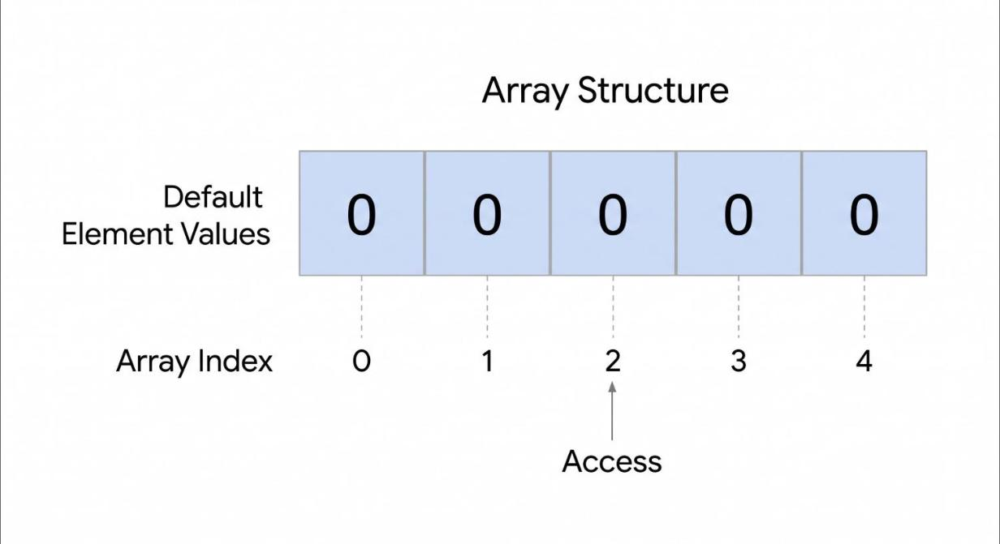

# T09 · Array · Beginner · V0 (Gemini Flash, no Gem) · 2026-10-31 · Suhani

Input: `Explain Array in Hindi for a Beginner learner`

Output (copied unchanged):

---

**Array (ऐरे)** प्रोग्रामिंग में एक ऐसा **Data Structure** है, जिसका इस्तेमाल एक जैसे प्रकार (Same Data Type) के कई सारे डेटा वैल्यूज को एक ही वेरिएबल (Variable) नाम के तहत स्टोर करने के लिए किया जाता है।

सरल शब्दों में कहें तो, अगर आपको 5 छात्रों के मार्क्स स्टोर करने हों, तो 5 अलग-अलग वेरिएबल (`marks1`, `marks2`, `marks3`...) बनाने के बजाय आप एक ही Array बना सकते हैं।



## 1. Array की मुख्य अवधारणाएं (Key Concepts)

* **Element (एलिमेंट):** Array के अंदर स्टोर की गई हर एक वैल्यू को "Element" कहते हैं।
* **Index (इंडेक्स):** Array में हर वैल्यू की अपनी एक पोजीशन (स्थान) होती है जिसे Index कहते हैं।

  > **ध्यान दें:** ज्यादातर प्रोग्रामिंग भाषाओं (जैसे C, C++, Java, Python, JavaScript) में Array का इंडेक्स **0 से शुरू** होता है। पहले एलिमेंट का इंडेक्स `0`, दूसरे का `1`, और तीसरे का `2` होता है।

## 2. असली दुनिया का उदाहरण (Real-world Analogy)

Array को आप **दवाइयों के बॉक्स (Pill Box)** या **अंडे की ट्रे (Egg Tray)** जैसा समझ सकते हैं:

* जैसे एक ट्रे में कई खांचे बने होते हैं और हर खांचे में एक अंडा रखा जा सकता है।
* आप किसी भी खांचे को उसके नंबर (Index) से पहचान सकते हैं।

## 3. Array का इस्तेमाल कैसे करते हैं? (C / Java / JavaScript का उदाहरण)

यदि आपको 5 नंबरों का एक Array बनाना है:

```plaintext
[ 10, 20, 30, 40, 50 ]
  |   |   |   |   |
  0   1   2   3   4  <-- Index
```

### किसी वैल्यू को एक्सेस करना (Accessing Values)

* `numbers[0]` → **10** (पहला एलिमेंट)
* `numbers[2]` → **30** (तीसरा एलिमेंट)
* `numbers[4]` → **50** (पांचवा एलिमेंट)

## 4. Array के फायदे और नुकसान

| फायदे (Advantages) | नुकसान (Disadvantages) |
| --- | --- |
| **फास्ट एक्सेस (Fast Access):** इंडेक्स नंबर के जरिए किसी भी एलिमेंट को तुरंत ढूंढा जा सकता है। | **फिक्स साइज (Fixed Size):** कई भाषाओं में इसका साइज बनाने के बाद बदला नहीं जा सकता। |
| **कोड की बचत:** बहुत सारे अलग-अलग वेरिएबल्स बनाने की जरूरत नहीं पड़ती। | **मेमोरी की समस्या:** बीच में नए एलिमेंट्स जोड़ना या हटाना थोड़ा धीमा और कठिन होता है। |
