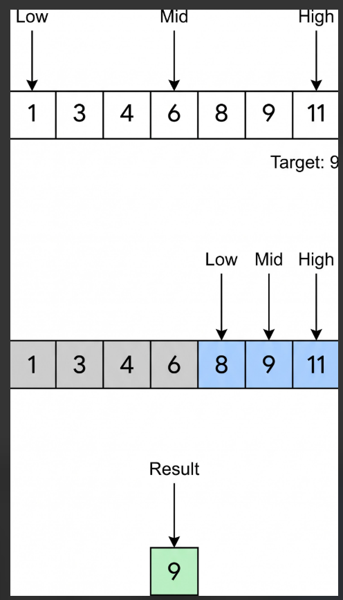

# T29 · Binary search · Beginner · V0 (Gemini Flash, no Gem) · 2026-11-01 · Ashima

Input: `Explain Binary search in Hindi for a Beginner learner`

Output (copied unchanged):

\---

बाइनरी सर्च (Binary Search) कंप्यूटर साइंस में डेटा को तेजी से खोजने (searching) का एक बहुत ही शानदार और लोकप्रिय तरीका (Algorithm) है। यह काम तभी करता है जब आपका डेटा पहले से क्रमबद्ध (Sorted) यानी बढ़ते या घटते क्रम में हो।

आइए इसे बहुत ही आसान भाषा में समझते हैं।

दैनिक जीवन का एक उदाहरण: डिक्शनरी (Dictionary) में शब्द खोजना

मान लीजिए आपके पास अंग्रेजी की एक मोटी डिक्शनरी है और आपको उसमें "Python" शब्द ढूंढना है।

* गलत तरीका (Linear Search): आप पहले पन्ने से शुरू करें और एक-एक शब्द को तब तक चेक करें जब तक "Python" न मिल जाए। इसमें बहुत समय लगेगा।
* सही तरीका (Binary Search): आप डिक्शनरी को ठीक बीच (Middle) से खोलते हैं। मान लीजिए बीच में "M" अक्षर वाले शब्द आते हैं। चूंकि 'P' अक्षर 'M' के बाद आता है, इसलिए आप बाएं हिस्से के सभी पन्नों को तुरंत छोड़ देते हैं और सिर्फ दाएं हिस्से पर ध्यान केंद्रित करते हैं। फिर दाएं हिस्से के बीच का पन्ना खोलते हैं और यही प्रक्रिया दोहराते हैं।

डिक्शनरी ढूंढने का यही स्मार्ट तरीका Binary Search कहलाता है!

बाइनरी सर्च कैसे काम करता है? (Step-by-Step)

मान लीजिए आपके पास यह सॉर्टेड एरे (Array) है और आपको इसमें 23 ढूंढना है:

\[2, 5, 8, 12, 16, 23, 38, 56, 72]

1. बीच का तत्व (Midpoint) निकालें:
सूची के सबसे पहले (Low) और सबसे आखिरी (High) हिस्से को जोड़कर बीच का इंडेक्स (Mid) निकाला जाता है।
2. तुलना करें (Compare):
बीच वाले नंबर की तुलना उस नंबर से करें जिसे आप ढूंढ रहे हैं (यानी 23):

   * अगर बीच वाला नंबर ही 23 है, तो काम खत्म! मिल गया।
   * अगर 23, बीच वाले नंबर से छोटा है, तो हम सिर्फ बाएं (Left) हिस्से में खोजेंगे और दाएं हिस्से को भूल जाएंगे।
   * अगर 23, बीच वाले नंबर से बड़ा है, तो हम सिर्फ दाएं (Right) हिस्से में खोजेंगे।
3. दोहराएं (Repeat):
यही प्रक्रिया तब तक दोहराई जाती है जब तक नंबर मिल न जाए या सूची खत्म न हो जाए।

बाइनरी सर्च क्यों खास है?

* बहुत तेज गति ($O(\\log n)$): अगर आपके पास 10 लाख आइटम हैं, तो साधारण तरीके (Linear Search) से खोजने में अधिकतम 10 लाख कदम लग सकते हैं, लेकिन बाइनरी सर्च में केवल 20 कदम में ही सही उत्तर मिल जाता है!
* शर्त: इसके लिए जरूरी है कि डेटा हमेशा Sorted (क्रमबद्ध) होना चाहिए।

