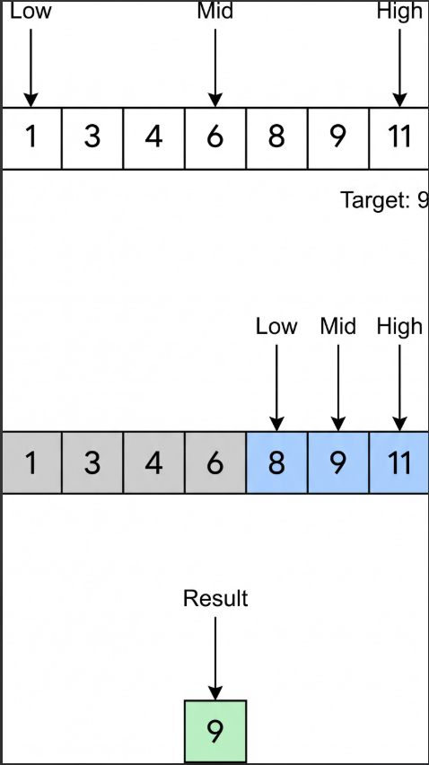

# T30 · Binary search · Intermediate · V0 (Gemini Flash, no Gem) · 2026-11-01 · Ashima

Input: `Explain Binary search in Hindi for a Intermediate learner`

Output (copied unchanged):

\---

बाइनरी सर्च (Binary Search) कंप्यूटर साइंस के सबसे महत्वपूर्ण और तेज़ एल्गोरिदम में से एक है। इसका उपयोग किसी सॉर्टेड (Sorted - क्रमबद्ध) एरे या लिस्ट में से किसी विशिष्ट तत्व (Target element) को खोजने के लिए किया जाता है।

चूंकि आप एक इंटरमीडिएट स्तर के शिक्षार्थी हैं, आइए इसे इसके लॉजिक, काम करने के तरीके और पाइथन कोड के साथ गहराई से समझते हैं।

यह लीनियर सर्च से बेहतर क्यों है?

साधारण लीनियर सर्च (Linear Search) शुरुआत से लेकर अंत तक एक-एक करके हर एलिमेंट की जांच करता है, जिसकी टाइम कॉम्प्लेक्सिटी $O(n)$ होती है।

इसके विपरीत, बाइनरी सर्च "Divide and Conquer" (विभाजन और विजय) के सिद्धांत पर काम करता है। यह हर चरण में सर्च स्पेस को आधा कर देता है, जिससे इसकी टाइम कॉम्प्लेक्सिटी घटकर $O(\\log n)$ हो जाती है। यानी अगर लिस्ट में 1,000,000 एलिमेंट्स हैं, तो लीनियर सर्च को 10 लाख स्टेप्स लग सकते हैं, जबकि बाइनरी सर्च अधिकतम सिर्फ 20 स्टेप्स में ढूंढ लेगा!

बाइनरी सर्च कैसे काम करता है? (Algorithm Steps)



बाइनरी सर्च लागू करने के लिए दो शर्तें ज़रूरी हैं: डेटा हमेशा सॉर्टेड होना चाहिए और एलिमेंट्स तक रैंडम एक्सेस (इंडेक्सिंग) होनी चाहिए।

1. पॉइंटर्स सेट करें: लिस्ट के दो कोने तय करें — low (शुरुआत, इंडेक्स 0) और high (अंत, इंडेक्स length - 1)।
2. मध्य बिंदु (Midpoint) निकालें: mid = low + (high - low) // 2 (यह तरीका बड़े नंबर्स में इंटीजर ओवरफ्लो से बचाता है)।
3. तुलना करें (Comparison):

   * यदि arr\[mid] == target, तो आपको आपका एलिमेंट मिल गया! इंडेक्स mid रिटर्न कर दें।
   * यदि arr\[mid] < target, इसका मतलब टारगेट दाईं ओर है। इसलिए low = mid + 1 कर दें।
   * यदि arr\[mid] > target, इसका मतलब टारगेट बाईं ओर है। इसलिए high = mid - 1 कर दें।
4. दोहराएं: जब तक low <= high रहे, यह प्रक्रिया दोहराते रहें। यदि low > high हो जाए और एलिमेंट न मिले, तो इसका मतलब तत्व लिस्ट में मौजूद नहीं है (Return -1)।

पाइथन में कोड का उदाहरण (Python Implementation)

यहाँ बाइनरी सर्च का एक साफ-सुथरा इटेटिव (Iterative) कोड दिया गया है:

```python
def binary\_search(arr, target):
    low = 0
    high = len(arr) - 1
    
    while low <= high:
        mid = low + (high - low) // 2
        
        # चेक करें कि क्या टारगेट बीच में है
        if arr\[mid] == target:
            return mid
        
        # अगर टारगेट मिड से बड़ा है, तो बाईं ओर के हिस्से को छोड़ दें
        elif arr\[mid] < target:
            low = mid + 1
            
        # अगर टारगेट मिड से छोटा है, तो दाईं ओर के हिस्से को छोड़ दें
        else:
            high = mid - 1
            
    return -1  # एलिमेंट नहीं मिला

# उदाहरण के लिए उपयोग:
sorted\_numbers = \[2, 5, 8, 12, 16, 23, 38, 56, 72, 91]
target\_value = 23

result = binary\_search(sorted\_numbers, target\_value)

if result != -1:
    print(f"एलिमेंट इंडेक्स {result} पर मिल गया है।")
else:
    print("एलिमेंट लिस्ट में मौजूद नहीं है।")
```

कॉम्प्लेक्सिटी (Complexity Analysis)

* टाइम कॉम्प्लेक्सिटी (Time Complexity):

  * बेस्ट केस (Best Case): $O(1)$ (जब पहली बार में ही मिडिल एलिमेंट टारगेट मिल जाए)।
  * वर्स्ट और एवरेज केस (Worst/Average Case): $O(\\log n)$ (हर बार डेटा आधा होने के कारण)।
* स्पेस कॉम्प्लेक्सिटी (Space Complexity):

  * इटेटिव दृष्टिकोण (Iterative): $O(1)$ (क्योंकि हम केवल कुछ पॉइंटर वेरिएबल्स का उपयोग कर रहे हैं)।

